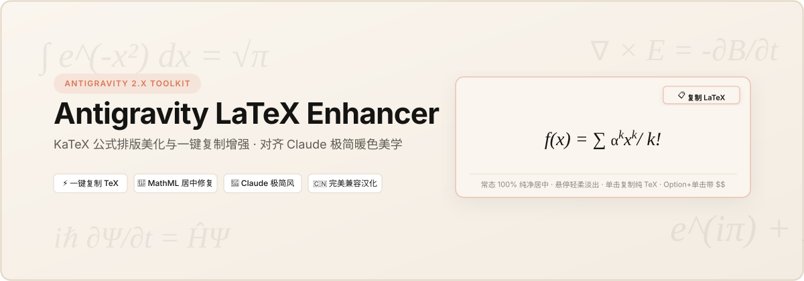

<div align="center">



<br/>

[](https://github.com/Fengtang1314/antigravity-latex-enhancer/releases/latest)

<br/>

[](#)
[](#)
[](#)
[](#)
[](#)
[](LICENSE)

<p align="center">
  <b>专为 Google Antigravity 打造的 LaTeX 公式排版美化与一键复制增强插件</b><br/>
  <i>无侵入 Sidecar + 本地 CDP 动态注入 · 保留官方签名与自动更新 · 零依赖支持热启停</i>
</p>

[🚀 极速安装](#-极速安装免-sudo) •
[⚡ 效果对比](#-效果对比) •
[🏗️ 架构与特性](#️-v300-架构与核心特性) •
[❓ 常见问题](#-常见问题)

</div>

---

## 🚀 极速安装（免 `sudo`）

> **前置要求**：macOS + Node.js `>= 22`（客户端需为 Antigravity Desktop `2.33+`，已验证兼容 `2.34.0` 自动升级）。

### 方式一：下载发行包双击安装（推荐）

1. 前往 **[Releases 页面](https://github.com/Fengtang1314/antigravity-latex-enhancer/releases/latest)** 下载 `antigravity-latex-enhancer-v3.0.0.zip` 并解压；
2. 双击运行 **`双击安装公式增强.command`**（全程用户态运行，**无需输入开机密码**）；
3. 安装完成后，Antigravity 会自动拉起 Sidecar 并动态生效（若尚未激活，重启一次客户端即可）。

> 若从浏览器下载的 `.command` 触发 macOS Gatekeeper 提示，右键点击脚本选择 **“打开”** 即可。

### 方式二：命令行管理（开发者）

```bash
git clone https://github.com/Fengtang1314/antigravity-latex-enhancer.git
cd antigravity-latex-enhancer

node manage.mjs install     # 安装至 ~/.gemini/config/plugins/ 并启用
node manage.mjs status      # 查看注入状态、窗口数与调试端口诊断
node manage.mjs disable     # 热停用（≤3s 自动调用 dispose() 无痕卸载，无需重启）
node manage.mjs enable      # 热启用（≤3s 重新注入，无需重启）
node manage.mjs uninstall   # 完全卸载用户态插件（不触碰 app.asar）
```

> **关于调试端口**：Antigravity `2.33+` 需带 `--remote-debugging-port=0 --remote-debugging-address=127.0.0.1` 启动以生成 `<profile>/DevToolsActivePort`。本插件只读复用该共享端口，**不会**抢占重启客户端或修改 `~/Applications/Antigravity (Debug).app`（可与 `antigravity-pulse` 零冲突共存）。

---

## ⚡ 效果对比

| 体验维度 | Antigravity 原生渲染 | **LaTeX Enhancer v3.0.0** |
| :--- | :--- | :--- |
| **居中与超宽滚动** | MathML 占位导致公式整体右偏；超宽矩阵左侧易裁切 | **裁剪 MathML 占位，`inline-block` 解耦滚动容器，居中且从 `0` 坐标完整滚动** |
| **防挤压排版间距** | 连续 `$$` 公式与正文容易紧贴碰撞 | **连续块级公式强制 `28px` 呼吸间距，正文/列表交界 `18~20px` 隔离** |
| **主题与视觉质感** | 无悬停反馈与一键复制 | **默认 `#FAF5EE` 暖白纸面与 `#D97757` 陶土橙微标，自动适配浅/深色主题** |
| **一键复制 TeX** | 无法直接提取源码 | **单击复制纯 LaTeX；按住 `Option (⌥)` 单击自动包裹 `$...$` / `$$...$$`** |
| **选区 `Cmd + C`** | 复制出 KaTeX 重影碎字符或段落粘连 | **智能还原为标准 Markdown 公式，严格保留段落、列表与表格列分隔** |
| **安装与更新维护** | 旧版修改 `app.asar` 会丢官方签名，更新即失效 | **纯用户态 Sidecar + CDP 注入，`app.asar` 零修改，官方更新后自动无感延续** |

---

## 🏗️ v3.0.0 架构与核心特性

```text
~/.gemini/config/plugins/antigravity-latex-enhancer/
  ├── sidecars/panel/main.mjs  ──► 宿主拉起的轻量 Sidecar（含侧边栏状态诊断页）
  └── compat/runtime-cdp.mjs   ──► 只读复用 <profile>/DevToolsActivePort
        │
        └─► 仅针对 Antigravity 主会话 page target 注入 payload/voyager-latex.js
              ├── Page.addScriptToEvaluateOnNewDocument（刷新/切换会话自恢复）
              └── window.__VOYAGER_LATEX_DISPOSE__()（停用/卸载时全量回收）
```

- **零外部运行时依赖**：安装、启停、诊断与 Sidecar 运行均基于 Node.js 原生标准库，无需安装 `npm` 依赖或提权。
- **精确宿主页隔离**：通过 `HOST_PROBE_EXPR` 二次校验排除 `chrome-error://` 与本地开发预览页，绝不污染其他标签页；支持多窗口并发挂载。
- **可卸载生命周期与性能优化**：内置版本比对与 `dispose()` 全量清理（`WeakRef` 追踪销毁全部 ShadowRoot 观察器、`rAF` 增量子树扫描、定时器与事件解绑）；完全消除 `innerHTML`（改用 `replaceChildren()`），兼容 Chromium **Trusted Types**。
- **侧边栏状态诊断**：在对话框左侧 **「＋ → Extensions → LaTeX Enhancer」** 可随时查看注入窗口数、调试端口与载荷版本，并支持一键重新注入。

---

## 🧪 测试验证

```bash
npm test
```

本地回归矩阵覆盖 **135 项测试**（5 个测试套件）：
- `tests/test_payload.js`（31 项）：排版装饰、Shadow DOM、点击复制、白名单保护、选区 Markdown 还原与注入安全
- `tests/test_dispose_tt.js`（27 项）：Trusted Types 零 `innerHTML` 陷阱、版本热替换、`dispose()` 全回收与边界防护
- `tests/test_runtime_cdp.js`（17 项）：Target 过滤、宿主/预览页隔离、停用清理、缺失端口被动诊断与 `SidecarOwner` 仲裁
- `tests/test_lifecycle.js`（19 项）：沙箱 `HOME` 全生命周期验证、共享配置无损保留与旧版 `app.asar` 检测阻断
- `tests/test_engine.js`（41 项）：归档的旧版 `legacy/voyager_engine.js` 事务回归（安装 `@electron/asar` 时自动运行）

---

## ❓ 常见问题

<details>
<summary><b>Q1：Antigravity 客户端自动升级后公式增强会失效吗？</b></summary>

**不会**。插件运行在 `~/.gemini/config/plugins/` 下，完全不修改 `Antigravity.app` 本体（已实测客户端从 `2.33.0` 自动升级至 `2.34.0` 后无需任何手动重装，Sidecar 自动续接注入）。
</details>

<details>
<summary><b>Q2：之前安装过 v2.x 旧版（修改过 `app.asar`）如何迁移？</b></summary>

v3.0.0 的 `manage.mjs install` 会自动以只读方式检测 `app.asar` 是否仍含有旧版 `VOYAGER-LATEX-START` 注入标记；若检测到残留，会先阻断安装以防止双份注入与签名异常。请先完全退出客户端并运行：
```bash
sudo node legacy/voyager_engine.js uninstall
```
（或直接用官方最新安装包覆盖恢复 `/Applications/Antigravity.app`），随后再执行 `node manage.mjs install` 即可。
</details>

<details>
<summary><b>Q3：多行对齐公式（`aligned`）内部行距较紧怎么办？</b></summary>

这是 KaTeX 对 `\\` 默认 `\jot`（`0.25em`）的原生渲染特性。建议将含复杂分式/求和的公式拆分为独立 `$$ ... $$` 块（自动获得 `28px` 防挤压间距），或在多行对齐中显式使用 `\\[0.8em]` 增大行距。
</details>

---

## 🤝 致谢与开源协议

灵感源自 [Gemini Voyager](https://github.com) 与 [016/Antigravity-Better](https://github.com) 等先驱项目，Sidecar + CDP 架构参考自 `agy-context-dashboard`。基于 [MIT License](LICENSE) 开源。
