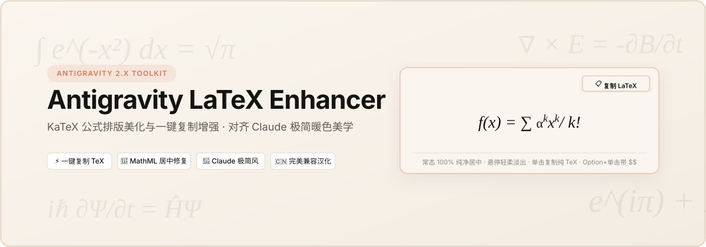

<div align="center">



<br/>

[](https://github.com/Fengtang1314/antigravity-latex-enhancer/releases/latest)

<br/>

[](LICENSE)
[-141413.svg?style=flat-square)](#)
[](#)
[](#)
[](#)

<p align="center">
  <b>专为 Google Antigravity 2.x (macOS) 打造的 LaTeX 公式美化与一键复制增强插件</b><br/>
  <i>彻底告别公式右偏与复制乱码 · 赋予 Claude 极简暖色美学 · 完美兼容中文汉化补丁</i>
</p>

[📥 极速下载与安装](#-极速下载与安装新手友好) •
[🌟 核心特性](#-核心功能亮点) •
[⚡ 效果对比](#-效果对比) •
[❓ 常见问题 (FAQ)](#-常见问题排坑-faq) •
[🛡️ 架构与安全](#️-架构与安全闭环) •
[🤝 致谢与开源协议](#-致谢与声明-acknowledgements)

</div>

---

### 🤔 你是否也在 Antigravity 中遇到过这些抓狂瞬间？

* ❌ **公式严重偏右**：公式明明写了居中，渲染出来却莫名其妙偏向屏幕右侧一大截，左边空出一大片？
* ❌ **复制全成乱码**：大模型推导出漂亮的公式，用鼠标划选复制出来却是一堆碎字符、缺失符号与重影，根本无法直接贴进论文或 Markdown？
* ❌ **多行堆叠太挤**：分式、求和号和大括号挤压在一起，上下行紧贴碰撞，缺乏视觉呼吸感？
* ❌ **汉化容易损坏**：动一下客户端配置就导致中文汉化补丁失效或应用报错？

👉 **本项目专为解决上述痛点而生**：
* 📐 **100% 水平正中居中**：彻底屏蔽 Chromium MathML 占位，Flexbox 绝对居中呈现；
* 📋 **鼠标悬浮一键复制**：轻移鼠标淡出微标，**单击直接复制纯 LaTeX 源码**，按住 `Option (⌥)` 自动智能补齐 `$$` 定界符；
* 🎨 **Claude 极简暖色美学**：平时完全透明零多余线框，悬停才轻柔浮现 `#FAF5EE` 暖白纸面质感；
* 🇨🇳 **汉化 100% 稳定共存**：独立命名空间隔离注入，与社区中文汉化补丁物理级解耦。

---

## 📥 极速下载与安装（新手友好）

### ⚙️ 前置运行环境
* **操作系统**：macOS 11.0 或更高版本（原生适配 Apple Silicon M1/M2/M3/M4 系列及 Intel 芯片）
* **客户端版本**：Google Antigravity 2.x
* **Node.js 环境**：需要 Node.js (推荐 v18 或更高版本，若电脑尚未安装，可前往 [nodejs.org](https://nodejs.org) 下载一键安装包)

---

### 🚀 安装三步走

普通用户无需手动执行任何繁琐命令，跟随以下三步即可轻松搞定：

#### 步骤 1：下载安装包
前往仓库右侧的 **[Releases 发行版页面](https://github.com/Fengtang1314/antigravity-latex-enhancer/releases/latest)**，下载预打包好的 **`antigravity-latex-enhancer-v2.1.0.zip`**，下载后双击解压为一个文件夹。

> 💡 **开发者方式**：也可以直接克隆本仓库：
> ```bash
> git clone https://github.com/Fengtang1314/antigravity-latex-enhancer.git
> ```

#### 步骤 2：一键自动安装
1. 按键盘快捷键 `Cmd + Q` **完全退出 Antigravity 客户端**；
2. 在解压出来的文件夹中，**双击运行 `双击安装公式增强.command`**；
3. 系统会弹出终端提示输入电脑开机密码以授予应用写入权限（输入时密码不显示，直接回车即可）；
4. 看到终端提示 `🎉 安装成功！` 后，按任意键关闭终端窗口。

> ⚠️ **macOS 安全提示与放行指引**：
> 从网络下载的压缩包解压后，macOS 系统可能会弹出 *“无法打开，因为无法验证开发者”* 的安全提示。此时只需：
> * **方法 1（推荐）**：**右键点击** `双击安装公式增强.command`，在右键菜单中选择 **“打开”**，然后在弹出的确认对话框中点击 **“打开”** 即可永久放行；
> * **方法 2**：在终端进入解压目录并运行：`xattr -d com.apple.quarantine *.command`。

#### 步骤 3：重启尽享丝滑体验
重新打开 Antigravity，所有的公式排版优化与一键复制功能已全自动生效！

---

## 🌟 核心功能亮点

本项目主要解决长期困扰 Antigravity / Electron 用户的高频痛点：

### 功能一：LaTeX 公式排版深度优化与美化
* **彻底根治公式居中向右偏移**：
  KaTeX 在 Electron/Chromium 下渲染时，其内部的 `<span class="katex-mathml">` 语义层会霸占左侧约 320px 的宽度，导致可见公式严重偏向右侧。本插件对其施加绝对定位与排版流裁剪，结合 Flexbox 真正达成 **100% 水平正中居中**。
* **Claude 极简人文纸面美学 (Minimalist Warmth)**：
  * **底色系统**：对齐 Claude 暖白纸面配色体系（`#FAF5EE` 纸面底色、`#141413` 炭灰文字、`#D97757` 标志性陶土橙）；
  * **常态零打扰**：无论是行内符号（如 `$x$`）还是独立公式块，平时**完全透明、零灰色边框、零底色**，像书本正文一样纯净优雅；
  * **悬停微反馈**：鼠标移上公式时，才轻柔淡出温润微底色与陶土橙细致边框；
  * **告别原生灰色气泡**：屏蔽浏览器原生系统的灰底 Tooltip 气泡，视觉纯粹干净。

### 功能二：一键公式提取与 Markdown 复制增强
* **单击一键提取 TeX 源码**：
  无需费力选中，鼠标悬停在公式上浮现 `📋 复制 LaTeX` 微标，**轻轻单击**即可将纯 LaTeX 源码复制到剪贴板，右下角弹出 Claude 暖色微 Toast 提示。
* **按住 Option (⌥) 单击：智能定界符包裹**：
  需要直接贴进 Markdown 或论文草稿？按住 `Option (Alt)` 点击公式，自动为你智能包装好 `$$...$$`（块级）或 `$...$`（行内）。
* **选区 Cmd+C 智能拦截还原**：
  鼠标大面积划选包含中文字符和公式的整段回答按 `Cmd + C` 时，自动穿透 KaTeX 内部结构，将公式节点无损还原为干净的 Markdown TeX 源码，**彻底告别原生复制产生的重影字符与乱码**。

---

## ⚡ 效果对比

| 体验维度 | Antigravity 原版原生状态 | **安装本增强插件后** |
| :--- | :--- | :--- |
| **公式居中对齐** | Chromium MathML 占位，**公式整体向右严重偏离** | **裁剪 MathML 占位，Flexbox 绝对居中，100% 正中优雅呈现** |
| **视觉呈现质感** | 缺少呼吸感，深浅色对比突兀或僵硬 | **Claude 暖色极简纸面美学（`#FAF5EE` / `#141413` / `#D97757`），常态零边框零底色** |
| **一键复制 TeX** | ❌ 无法复制，右键无响应 | **✅ 鼠标悬停淡出微标，单击直接复制纯 LaTeX 源码** |
| **定界符智能包裹** | ❌ 需手动打字补充 `$$...$$` | **✅ 按住 Option (⌥) 单击公式，自动携带定界符复制** |
| **选区 Cmd+C 复制** | 复制出 KaTeX 内部重影字符与杂乱符号 | **智能拦截还原为标准的 Markdown 源码（如 `$x$` 与 `$$...$$`）** |
| **中文汉化共存** | 修改经常导致汉化丢失或客户端损坏 | **物理级解耦，与任何中文汉化补丁 100% 独立稳定共存** |

---

## 🔄 一键卸载与自愈

如果任何时候你不再需要本插件，或者想恢复至安装前的状态：
1. 完全退出 Antigravity 客户端；
2. 双击解压文件夹中的 **`双击卸载还原.command`**；
3. 引擎将调取安装前建立的独立冷备，1 秒内将客户端无痕恢复至初始状态。

---

## ❓ 常见问题排坑 (FAQ)

<details>
<summary><b>Q1: Antigravity 官方后续自动更新了版本，公式插件会失效吗？如何重新激活？</b></summary>

> **解答**：当客户端官方自动更新后，Electron 的 `app.asar` 核心文件会被官方新版本覆写。
> 你**完全不需要重新下载**本插件，只需重新双击运行一次解压包里的 **`双击安装公式增强.command`**，自动化引擎将在 3 秒内对新版客户端完成热注入与重签名，立即恢复公式增强！
</details>

<details>
<summary><b>Q2: 会与社区的 Antigravity 中文汉化补丁冲突吗？</b></summary>

> **解答**：**完全不冲突，100% 独立稳定共存**。
> 本插件采用物理级解耦架构，代码注入在专属隔离沙箱命名空间中，与汉化补丁的执行互不干涉。无论你先安装汉化还是先安装公式增强，都不会丢失汉化或造成损坏。
</details>

<details>
<summary><b>Q3: 为什么有时候多行公式内部的上下两行看起来有点挤？该如何排版？</b></summary>

> **解答（排版底层原理解析）**：
> 这是 TeX/KaTeX 排版引擎对多行对齐块（`\begin{aligned}`）的固有特性。TeX 原生多行公式的裸换行符 `\\` 默认间距增量（`\jot`）仅为固定值 $0.25\text{em}$（约 3~4px）。当某一行包含了“超大方括号 + 分母求和号 + 括号外挂下标”这种极端垂直深度时，下标会压低并紧挨着下一行的大写字母。
> 
> **推荐两种排版实践**：
> 1. **独占行展示（强烈推荐）**：含分式、求和号、复杂上下标的公式**一律独占行独立展示（`$$ ... $$`）**，每个公式均拥有独立宽裕的卡片呼吸边距，且可以被单独点击一键复制；
> 2. **显式传入行间距**：如果必须多行等号对齐，在源码换行符后显式加上行距参数（如 `\\[0.8em]` 或 `\\[1.0em]`），强制 TeX 引擎下移基线。
</details>

<details>
<summary><b>Q4: 卸载干净吗？会破坏我的 Antigravity 客户端吗？</b></summary>

> **解答**：非常干净。引擎在初次安装前建立了独立命名的冷备份（`app.asar.before-voyager`），卸载时不仅支持代码级精准剔除，还支持冷备文件 1 秒瞬间覆盖回滚，并自动更新签名哈希与系统门禁权限，绝不残留多余文件。
</details>

---

## 🛡️ 架构与安全闭环

* **纯本地零网络（Zero Network Call）**：代码不含任何 `fetch`、`XMLHttpRequest` 或网络模块，0 远程交互，0 Telemetry 跟踪。
* **零账号与 Token 风控风险**：纯前端 DOM 层样式装饰与剪贴板增强，完全不碰模型推理、通信 RPC 或身份验证头。
* **macOS 签名自愈**：自动化引擎在打包后自动更新 `Contents/Info.plist` 中的 `ElectronAsarIntegrity` 头部校验哈希，并调用原生 `codesign --force --deep --sign -` 重新签名与清理系统隔离标记，彻底杜绝系统“应用已损坏”弹窗。

---

## 🤝 致谢与声明 (Acknowledgements)

本项目在诞生过程中，深受开源社区先驱项目的启发：
* **[Gemini Voyager]**：感谢其在网页端开创的极简公式复制交互范式。
* **[016/Antigravity-Better]**：感谢其在早期版本样式探索上的先驱贡献。
* **[antigravity2汉化] 社区**：感谢汉化生态为 macOS 用户提供的卓越本地化支持。

---

## 📄 开源许可证

本项目基于 [MIT License](LICENSE) 协议开源。
